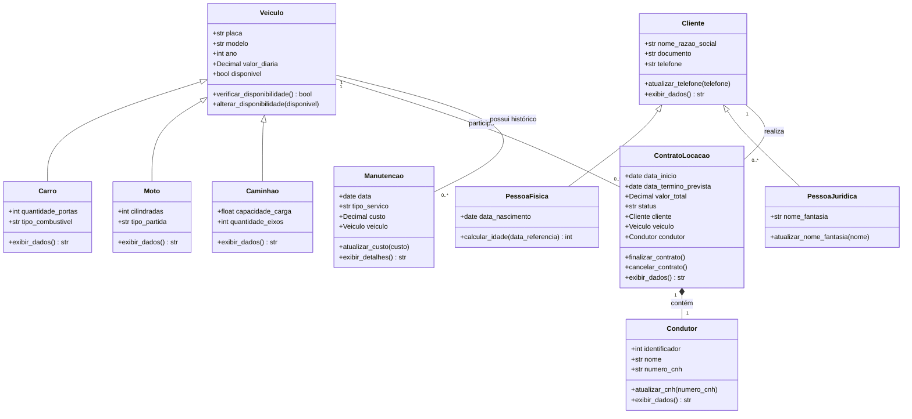

# Trabalho Prático 02 — Arquitetura de Software

**Estudo de caso:** Sistema de Gerenciamento de uma Locadora de Veículos  
**Curso:** Análise e Desenvolvimento de Sistemas  
**Turma:** Bloco IV — 2026.2  
**Aluno:** Nathan Moraes Almeida  
**Matrícula:** 01809219  
**Modalidade:** Individual

## Objetivo

Modelar uma locadora de veículos usando orientação a objetos, identificando classes, atributos, métodos, herança e relacionamentos. A implementação parcial em Python demonstra a composição entre um contrato de locação e seu registro de condutor.

## 1. Identificação das classes

| Classe | Responsabilidade |
| --- | --- |
| `Veiculo` | Representar as informações comuns dos veículos da locadora. |
| `Carro` | Especializar um veículo com características de carro. |
| `Moto` | Especializar um veículo com características de moto. |
| `Caminhao` | Especializar um veículo com características de caminhão. |
| `Cliente` | Representar o cadastro comum dos clientes. |
| `PessoaFisica` | Especializar o cliente identificado por CPF. |
| `PessoaJuridica` | Especializar o cliente identificado por CNPJ. |
| `ContratoLocacao` | Registrar o aluguel, suas datas, valor, status e responsáveis. |
| `Condutor` | Representar o registro do condutor responsável dentro de um contrato. |
| `Manutencao` | Registrar os serviços realizados em um veículo. |

## 2. Atributos e métodos

Cada classe possui pelo menos três atributos e dois métodos, considerando também os membros herdados. As características específicas não informadas no enunciado, como cilindradas e data de nascimento, são propostas de modelagem.

### Veiculo

- **Atributos:** `placa`, `modelo`, `ano`, `valor_diaria`, `disponivel`.
- **Métodos:** `verificar_disponibilidade()` consulta a disponibilidade; `alterar_disponibilidade(disponivel)` atualiza essa informação.

### Carro

- **Atributos herdados:** `placa`, `modelo`, `ano`, `valor_diaria`, `disponivel`.
- **Atributos específicos:** `quantidade_portas`, `tipo_combustivel`.
- **Métodos herdados:** `verificar_disponibilidade()` e `alterar_disponibilidade(disponivel)`.
- **Método específico:** `exibir_dados()` retorna os dados do carro, incluindo suas características específicas.

### Moto

- **Atributos herdados:** `placa`, `modelo`, `ano`, `valor_diaria`, `disponivel`.
- **Atributos específicos:** `cilindradas`, `tipo_partida`.
- **Métodos herdados:** `verificar_disponibilidade()` e `alterar_disponibilidade(disponivel)`.
- **Método específico:** `exibir_dados()` retorna os dados da moto, incluindo suas características específicas.

### Caminhao

- **Atributos herdados:** `placa`, `modelo`, `ano`, `valor_diaria`, `disponivel`.
- **Atributos específicos:** `capacidade_carga`, `quantidade_eixos`.
- **Métodos herdados:** `verificar_disponibilidade()` e `alterar_disponibilidade(disponivel)`.
- **Método específico:** `exibir_dados()` retorna os dados do caminhão, incluindo suas características específicas.

### Cliente

- **Atributos:** `nome_razao_social`, `documento`, `telefone`.
- **Métodos:** `atualizar_telefone(telefone)` altera o contato; `exibir_dados()` retorna os dados cadastrais.

### PessoaFisica

- **Atributos herdados:** `nome_razao_social` (nome), `documento` (CPF), `telefone`.
- **Atributo específico:** `data_nascimento`.
- **Métodos herdados:** `atualizar_telefone(telefone)` e `exibir_dados()`.
- **Método específico:** `calcular_idade(data_referencia)` calcula a idade na data indicada.

### PessoaJuridica

- **Atributos herdados:** `nome_razao_social` (razão social), `documento` (CNPJ), `telefone`.
- **Atributo específico:** `nome_fantasia`.
- **Métodos herdados:** `atualizar_telefone(telefone)` e `exibir_dados()`.
- **Método específico:** `atualizar_nome_fantasia(nome)` altera o nome fantasia.

### ContratoLocacao

- **Atributos:** `data_inicio`, `data_termino_prevista`, `valor_total`, `status`, `cliente`, `veiculo`, `condutor`.
- **Métodos:** `finalizar_contrato()` altera o status para finalizado; `cancelar_contrato()` altera o status para cancelado; `exibir_dados()` retorna um resumo do contrato.

### Condutor

- **Atributos:** `identificador`, `nome`, `numero_cnh`.
- **Métodos:** `atualizar_cnh(numero_cnh)` atualiza o número cadastrado; `exibir_dados()` retorna nome e CNH.

### Manutencao

- **Atributos:** `data`, `tipo_servico`, `custo`, `veiculo`.
- **Métodos:** `atualizar_custo(custo)` altera o custo registrado; `exibir_detalhes()` retorna os dados do serviço.

## 3. Herança

### Hierarquia de veículos

`Veiculo` é a superclasse de `Carro`, `Moto` e `Caminhao`. Todos compartilham placa, modelo, ano, valor da diária e disponibilidade. Cada subclasse acrescenta características próprias. A herança permite reutilizar os atributos e comportamentos comuns sem repeti-los em cada tipo de veículo.

### Hierarquia de clientes

`Cliente` é a superclasse de `PessoaFisica` e `PessoaJuridica`. Ambas compartilham nome ou razão social, documento e telefone. Na pessoa física, o documento é o CPF; na pessoa jurídica, é o CNPJ. Cada subclasse acrescenta informações específicas.

Os atributos e métodos herdados fazem parte das subclasses mesmo quando não são repetidos nos respectivos blocos do diagrama UML.

## 4. Relacionamentos entre classes

| Classes relacionadas | Tipo | Justificativa | Multiplicidade |
| --- | --- | --- | --- |
| `Cliente` e `ContratoLocacao` | Associação | O contrato se vincula a um cliente, mas o cadastro do cliente existe independentemente dos contratos. | Um cliente pode ter zero ou vários contratos; cada contrato possui exatamente um cliente. |
| `Veiculo` e `ContratoLocacao` | Associação | O contrato utiliza um veículo específico, que continua existindo independentemente do aluguel. | Um veículo pode ter zero ou vários contratos no histórico; cada contrato possui exatamente um veículo. |
| `ContratoLocacao` e `Condutor` | Composição | O registro do condutor pertence ao contrato e deve ser eliminado se esse contrato for excluído, conforme o enunciado. | Cada contrato possui um registro de condutor; cada registro pertence exclusivamente a um contrato. |
| `Veiculo` e `Manutencao` | Associação | O enunciado define o vínculo da manutenção com um veículo, mas não determina que excluir o veículo deve apagar seu histórico. Por isso, não se presume dependência de ciclo de vida. | Um veículo pode ter zero ou várias manutenções; cada manutenção pertence a exatamente um veículo. |

### Observações sobre a classificação

- As relações entre `Veiculo` e seus tipos e entre `Cliente` e seus tipos são de **herança**, conforme a seção 3; não são associação, agregação ou composição.
- Pertencer a um único veículo não basta, por si só, para classificar `Manutencao` como composição. Se fosse estabelecido que as manutenções devem ser destruídas junto com o veículo, a composição seria uma alternativa. A associação adotada atende ao vínculo explicitamente descrito no enunciado.
- `Condutor` representa o **registro do responsável naquele contrato**, e não a existência da pessoa no mundo real. A mesma pessoa pode ser cadastrada em outro contrato por meio de outro registro.
- Finalizar ou cancelar um contrato não equivale a excluí-lo. Seus dados e os do condutor podem permanecer no histórico.

### Regras de negócio

1. Todo contrato deve estar vinculado a exatamente um cliente e um veículo.
2. Um veículo não pode participar de dois contratos ativos ao mesmo tempo.
3. Os estados previstos para o contrato são `ativo`, `finalizado` e `cancelado`.
4. A exclusão do contrato implica a exclusão de seu registro de condutor.
5. Cada manutenção deve estar vinculada a um único veículo.

A multiplicidade `0..*` entre veículo e contrato representa o histórico. A restrição de no máximo um contrato ativo é uma regra adicional.

## Diagrama de classes

O arquivo [diagrama-classes.mermaid](diagrama-classes.mermaid) contém a versão editável do diagrama. O mesmo conteúdo está incorporado abaixo para visualização no README do GitHub.



**Legenda:** o triângulo vazio aponta para a superclasse; o losango preenchido fica no todo, indicando composição. As linhas simples representam associação. `0..*` significa zero ou muitos objetos relacionados.

O diagrama apresenta a modelagem completa; o código implementa apenas as duas classes exigidas no item 5.

## 5. Implementação parcial em Python

O arquivo [locadora.py](locadora.py) implementa `ContratoLocacao` e `Condutor`, relacionadas por **composição**.

O contrato cria seu próprio registro de condutor dentro do construtor:

```python
self.condutor = Condutor(1, nome_condutor, numero_cnh)
```

A classe que representa o todo (`ContratoLocacao`) controla a criação da parte (`Condutor`). O construtor recebe os dados do responsável e instancia o registro, demonstrando o relacionamento solicitado.

### Escopo da implementação

- Implementa exatamente as duas classes escolhidas.
- Usa `date` para as datas e `Decimal` para o valor monetário.
- Rejeita término anterior ou igual ao início e valores negativos.
- Permite finalizar ou cancelar um contrato e atualizar a CNH do registro de condutor.
- Representa cliente e veículo por identificadores, sem implementar suas classes neste recorte.

A composição é uma decisão de modelagem. Em Python, referências externas podem manter um objeto na memória; criá-lo dentro do contrato não garante sua destruição automática em todas as situações. Em um sistema com persistência, a exclusão do registro de condutor junto com o contrato precisaria ser implementada explicitamente. O exemplo demonstra a criação e a propriedade da parte, sem banco de dados.

A verificação de que um veículo não possui outro contrato ativo exige consultar os contratos do sistema e está fora deste recorte. O exemplo também não implementa validação oficial de CNH ou geração de identificadores únicos: o identificador `1` do condutor é ilustrativo.

### Como executar

**Requisito:** Python 3.6 ou superior. Não há dependências externas.

Baixe ou clone o repositório, abra um terminal na pasta dos arquivos e execute:

```bash
python locadora.py
```

Se o ambiente utilizar o comando `python3`, execute:

```bash
python3 locadora.py
```

### Saída esperada

```text
Cliente: CLI001 | Veículo: ABC1D23
Valor: R$ 600,00 | Status: ativo
Condutor: João da Silva | CNH: 12345678900
Após finalizar: finalizado
```

## Arquivos do repositório

| Arquivo | Conteúdo |
| --- | --- |
| `README.md` | Respostas aos cinco itens, justificativas, diagrama e instruções de execução. |
| `locadora.py` | Implementação parcial e exemplo executável de composição. |
| `diagrama-classes.mermaid` | Código-fonte do diagrama UML. |

## Conclusão

A modelagem reutiliza características comuns por meio de herança, associa os contratos aos clientes e veículos e utiliza composição para o registro de condutor. A implementação parcial demonstra esse relacionamento em Python, conforme o escopo solicitado.

**Fonte:** enunciado do Trabalho Prático 02 da disciplina Arquitetura de Software, turma Bloco IV — 2026.2.
